# GEZARMA

Sistema de gestión de **RMA** (devoluciones, garantías y reparaciones) para un servicio técnico: los clientes cargan sus reclamos y siguen el estado del equipo, y el taller diagnostica, repara, presupuesta y despacha, con historial completo de cada caso.

Backend en **FastAPI** + SQLAlchemy (SQLite por defecto) y frontend en HTML/JS sin build, servido por la misma app.

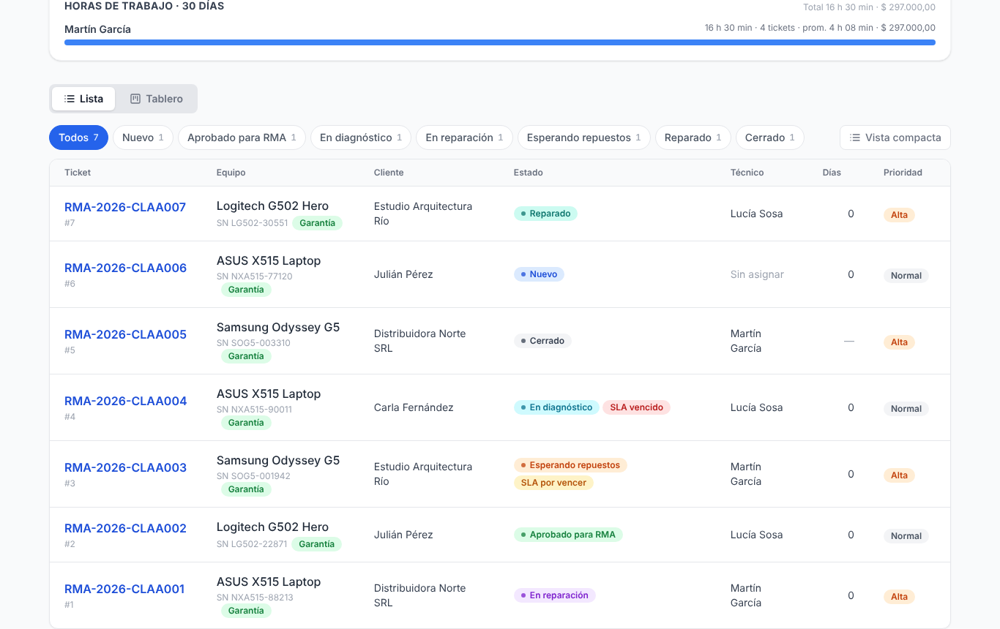

## Funcionalidades

- **Tickets RMA** con número correlativo, estados configurables, prioridad, SLA, técnico asignado, etiquetas, tickets clonados/relacionados y datos de envío.
- **Diagnóstico** con plantillas, **repuestos usados** con descuento de stock y **adjuntos** (PDF, TXT, JPG, PNG; hasta 10 MB por ticket).
- **Comentarios** con el cliente y **notas internas** solo para el taller.
- **Presupuestos** con versiones: el taller ve costo, precio y ganancia; el cliente ve el precio y lo aprueba o rechaza. Los ítems pueden ser repuestos del catálogo: al aprobarse, se descuentan del stock y se agregan al ticket. Las plantillas de ítems pueden ser de un modelo de producto: al presupuestarlo aparecen primero y se cargan todas juntas.
- **Importación desde Excel o CSV** de productos y repuestos, con vista previa fila por fila (nuevos, con cambios, errores), plantillas para bajar y exportación de lo cargado para editarlo y volver a subirlo.
- **Stock de repuestos** con historial de movimientos (no se borran: se anulan con un movimiento inverso que corrige también el ticket o el pedido), **stock mínimo** y aviso a los administradores cuando un repuesto lo cruza.
- **Ingreso en mostrador**: cliente (existente o nuevo, sin clave), equipo, **checklist de recepción** (accesorios, estado físico, si enciende, si tiene bloqueo), **fotos** desde el celular y **firma del cliente en pantalla**, en una sola pantalla; al terminar, etiqueta y comprobante en un click. La firma de entrega se toma desde el ticket.
- **Lector de código de barras**: escanear la etiqueta (o escribir un N° de RMA exacto en el buscador) abre el ticket directo.
- **Seguimiento público** sin login: el cliente consulta el estado con su N° de RMA y N° de serie (o escaneando el QR de su orden de ingreso).
- **Portal del cliente** (*Mis equipos*): sus equipos con todas las reparaciones, los documentos para bajar y lo que tiene pendiente (aprobar un presupuesto, retirar el equipo, calificar la reparación).
- **Listo para retirar**: aviso al cliente con la fecha límite, recordatorios y alerta al taller cuando vence el plazo de guarda.
- **Encuesta de satisfacción** al cerrar (de 1 a 5, desde la cuenta o el seguimiento público), con promedio y comentarios en el panel.
- **Garantía de la reparación**: si el mismo equipo vuelve dentro del plazo, el ticket se marca como reingreso, sube de prioridad y se avisa al técnico que lo reparó.
- **Tiempo de trabajo** por técnico (iniciar / pausar o cargar a mano), con costo de mano de obra y horas por técnico.
- **Horas** (atajo `G H`): calendario de horas de cada técnico por día, semana o mes; cargar a mano, mover entre días (arrastrando, o *Mover a…* en el celular), corregir y borrar con registro de cambios, tareas del taller sin ticket y exportación a Excel/CSV.
- **Pedidos a proveedor** en tres pasos: armar (con los repuestos bajo el mínimo o a mano), mandar (por mail con PDF y CSV, o marcarlo como pedido por otro medio) y recibir (todo o en partes, se suma al stock).
- **Documentos**: orden de ingreso, remito de entrega y presupuesto en PDF, **etiqueta** con QR y código de barras para pegar en el equipo, y **comprobantes de ingreso y de entrega para ticketera**.
- **Impresoras térmicas**: etiquetas de 62 × 29, 50 × 25, 40 × 30, 58 × 40 o 100 × 50 mm y ticketeras de 58 u 80 mm, a 203 o 300 dpi. El código de barras se arma a medida de la resolución de la impresora para que siempre se lea.
- **Notificaciones por email**: cambios de estado y presupuestos al cliente (con el PDF adjunto), asignaciones al técnico, stock bajo y SLA al taller.
- **Alertas de SLA**: tickets vencidos o por vencer en el dashboard y aviso automático, una sola vez por ticket.
- **Tablero Kanban** por estado: arrastrar una tarjeta a otra columna le cambia el estado.
- **Notificaciones** in-app, **favoritos**, búsqueda global y **historial/auditoría** de cada cambio.
- **Panel de administración**: usuarios, productos, repuestos, stock, pedidos a proveedor, etiquetas, estados, plantillas, finanzas, seguridad del login, **ajustes** (documentos, impresoras, email, retiro y encuesta, taller, SLA, seguimiento) y **exportación** a CSV/Excel.
- Bloqueo por intentos fallidos de login y cambio de contraseña obligatorio tras un reset.
- **Panel "Para hoy"**: SLA vencidos y por vencer, equipos listos para retirar, presupuestos sin respuesta y repuestos bajo el mínimo, cada uno con su lista.
- **Guía de primer uso** para el administrador (datos del taller, email, productos, un técnico y una etiqueta de prueba) e **impresión de prueba** de etiqueta y comprobante desde *Ajustes → Impresoras*.
- **Atajos de teclado** (`?` para verlos: `/` buscar, `N` nuevo ticket, `G` `T` tablero…), barra compacta en el celular, **Deshacer** al quitar etiquetas, repuestos o favoritos, y botones que muestran que están guardando.
- **Idiomas**: español (Argentina), español (España), inglés y portugués (Brasil). Cada usuario elige el suyo desde la barra superior (o el login); los mails, PDF y comprobantes le llegan al cliente en su idioma.

## Capturas

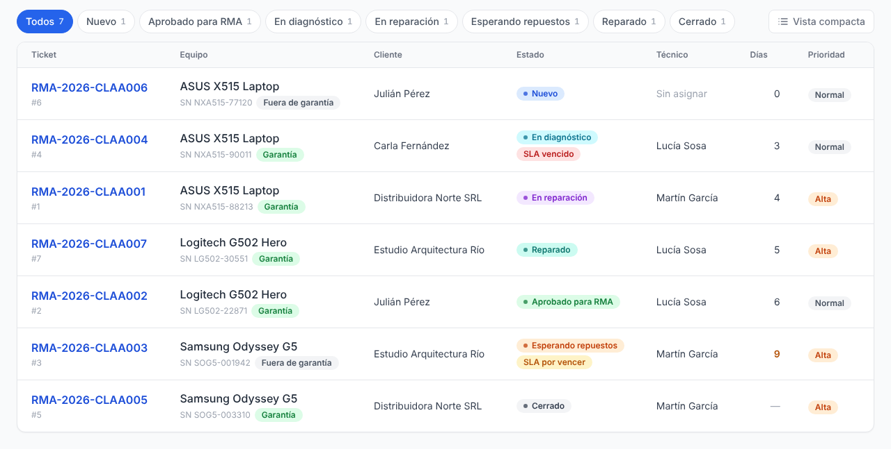

Lista de tickets: estados con su cantidad (filtran con un clic), días en el taller, alertas de SLA y orden por cualquier columna.

| Detalle del ticket (taller) | Detalle del ticket (cliente) |
|---|---|
| 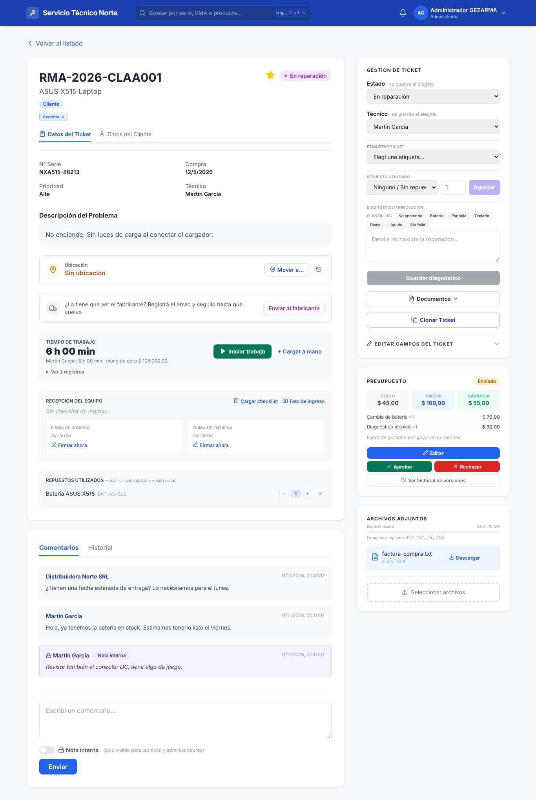 | 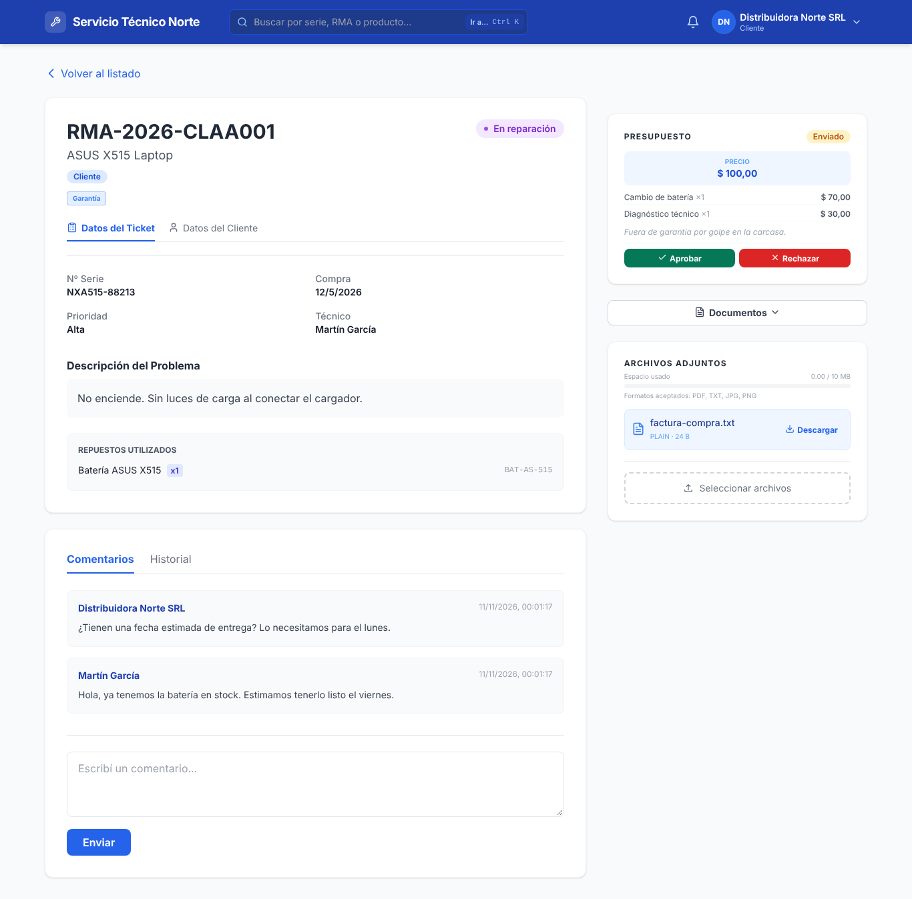 |
| Estado, técnico, diagnóstico, repuestos, nota interna y presupuesto con costo y ganancia. | El mismo ticket para el cliente: sin nota interna y el presupuesto solo con el precio. |

| Tablero Kanban | Seguimiento público (celular) |
|---|---|
| 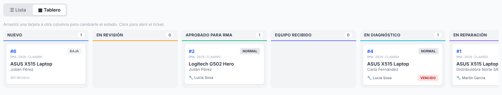 | 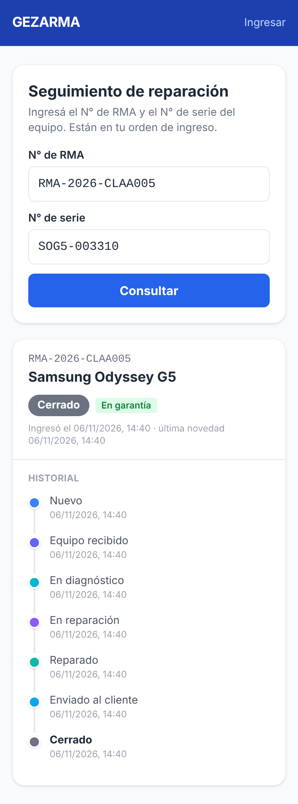 |
| Arrastrar una tarjeta a otra columna le cambia el estado. | Con el N° de RMA y el N° de serie, o escaneando el QR de la orden de ingreso. |

| Presupuesto en PDF | Etiqueta 62 × 29 mm |
|---|---|
| 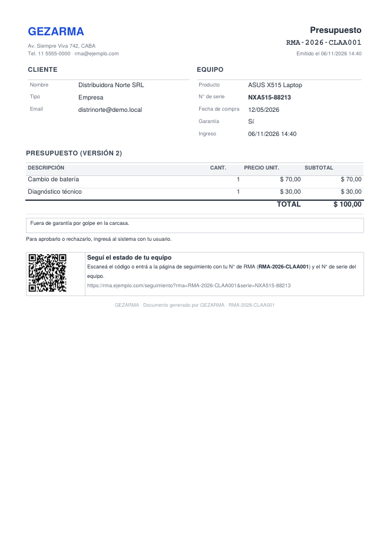 | 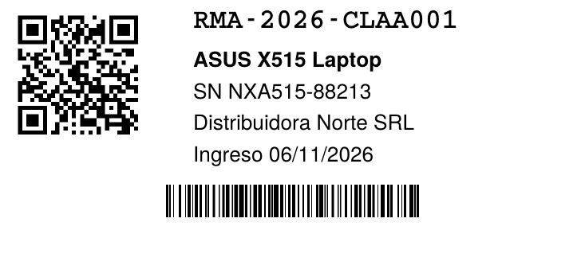 |
| Precios para el cliente (nunca costos) y QR al seguimiento. | QR que abre el ticket en el sistema y código de barras del N° de RMA. |

| Administración | Ajustes |
|---|---|
| 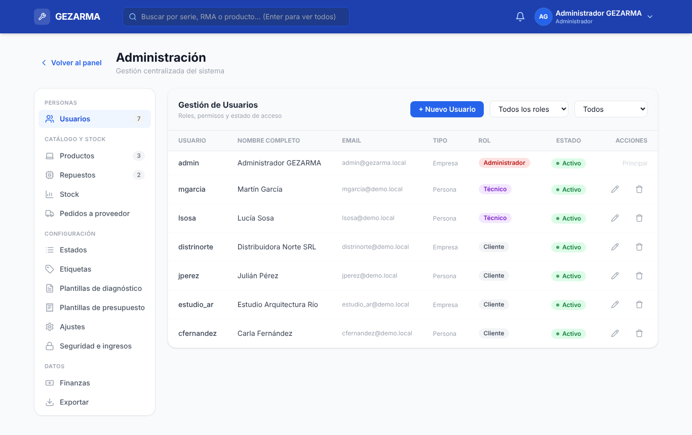 | 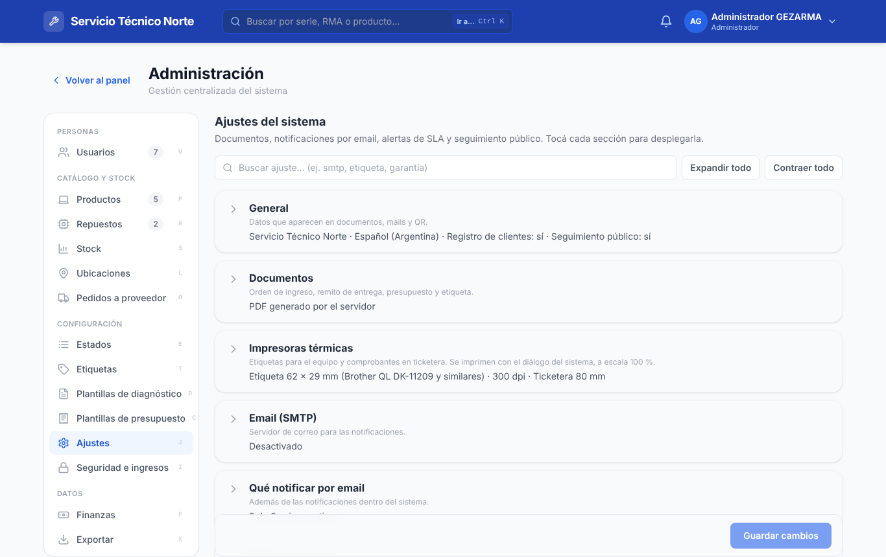 |
| Menú agrupado por tema; editar y eliminar desde los íconos de cada fila. | Nombre y logo del taller, mails, documentos, impresoras, SLA y más. |

| Horas | Login |
|---|---|
| 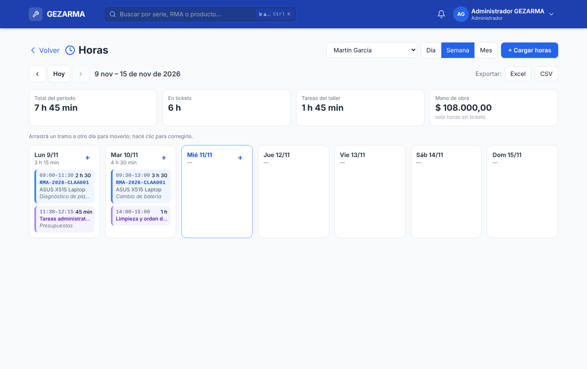 | 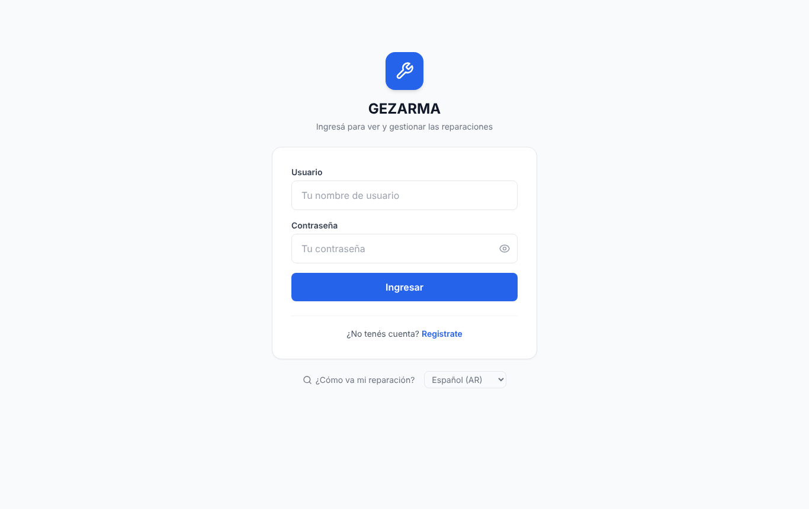 |
| Las horas de cada técnico día por día: arrastrar un tramo lo mueve de día, con clic se corrige. | Con el nombre y el logo del taller. |

*(Datos de demostración ficticios.)*

## Roles y permisos

| Acción | Cliente | Técnico | Administrador |
|---|:---:|:---:|:---:|
| Registrarse por su cuenta | ✅ | — | — |
| Crear tickets | ✅ | ✅ | ✅ |
| Ver tickets | solo los suyos | todos | todos |
| Comentar | ✅ | ✅ | ✅ |
| Notas internas | — | ✅ | ✅ |
| Subir / descargar adjuntos | en sus tickets | ✅ | ✅ |
| Ingreso en mostrador, checklist, fotos de ingreso y firmas | — | ✅ | ✅ |
| Borrar adjuntos | — | ✅ | ✅ |
| Cambiar estado, asignar técnico, diagnóstico, etiquetas, repuestos, envío | — | ✅ | ✅ |
| Crear, editar y enviar presupuestos | — | ✅ | ✅ |
| Ver costo interno y ganancia | — | ✅ | ✅ |
| Aprobar / rechazar presupuesto | los suyos | ✅ | ✅ |
| Mis equipos (portal) y calificar la reparación | los suyos | — | — |
| Registrar tiempo de trabajo | — | ✅ | ✅ |
| Ver y corregir horas de otros técnicos, o fuera del plazo | — | — | ✅ |
| Dashboard con estadísticas, alertas de SLA y stock, tablero Kanban, favoritos | — | ✅ | ✅ |
| Documentos: orden de ingreso, remito, presupuesto | los suyos | ✅ | ✅ |
| Etiqueta del equipo y comprobantes de ticketera | — | ✅ | ✅ |
| Exportar tickets, productos y repuestos | — | ✅ | ✅ |
| Administrar usuarios, productos, repuestos, stock, etiquetas, estados y plantillas | — | — | ✅ |
| Finanzas, seguridad del login, ajustes, exportar usuarios | — | — | ✅ |
| Pedidos a proveedor y horas por técnico | — | — | ✅ |

El **seguimiento público** (`/seguimiento`) no requiere usuario: lo puede consultar cualquiera que tenga el N° de RMA **y** el N° de serie del equipo, y muestra solo el estado, la línea de tiempo y los datos de envío.

El registro público siempre crea usuarios **cliente**. Los técnicos y administradores los crea un administrador desde *Administración → Usuarios → Nuevo usuario*.

## Instalación

### Con Docker (recomendado)

```bash
git clone https://github.com/dev-lang/gezarma.git
cd gezarma
cp .env.example .env          # completá al menos SECRET_KEY y ADMIN_PASSWORD
docker compose up -d --build
```

La app queda en <http://localhost:8000> (el puerto se cambia con `PORT` en `.env`). La base de datos y los adjuntos se guardan en el volumen `gezarma-data`, así que sobreviven a reconstruir o borrar el contenedor.

Para actualizar: `git pull && docker compose up -d --build`. Las migraciones de la base corren solas al arrancar.

> **Al actualizar una instalación anterior a noviembre 2026:** una migración pasa a UTC las fechas que se guardaban en hora local, usando `TIMEZONE`. Si el servidor viejo no estaba en hora argentina, definí `TIMEZONE` con su zona **antes** de actualizar.

### Local (sin Docker)

Requiere Python 3.11 o superior.

```bash
python -m venv .venv
source .venv/bin/activate      # Windows: .venv\Scripts\activate
pip install -r backend/requirements.txt
cp .env.example .env           # opcional
uvicorn backend.app.main:app --reload --host 0.0.0.0 --port 8000
```

Se ejecuta desde la raíz del repo. Por defecto la base (`rma_system.db`) y los adjuntos (`uploads/`) quedan en esa misma carpeta.

> El frontend carga Tailwind CSS y Chart.js desde CDN, así que el navegador necesita acceso a internet.

#### En Windows (PowerShell)

La primera vez, **parado en la carpeta del repo** (la que tiene `backend`, `frontend` y este README):

```powershell
cd C:\ruta\a\gezarma
py -m venv .venv
.venv\Scripts\Activate.ps1
pip install -r backend\requirements.txt
copy .env.example .env         # opcional
uvicorn backend.app.main:app --host 0.0.0.0 --port 8000
```

Abrí <http://localhost:8000>. Para frenarlo: `Ctrl + C`.

Los días siguientes alcanza con entrar a la carpeta, activar el entorno y arrancar:

```powershell
cd C:\ruta\a\gezarma
.venv\Scripts\Activate.ps1
uvicorn backend.app.main:app --host 0.0.0.0 --port 8000
```

Para actualizar, con el servidor frenado: `git pull` y después `pip install -r backend\requirements.txt`. La base y los adjuntos no se tocan, y las migraciones corren solas al arrancar.

Problemas comunes:

- **"la ejecución de scripts está deshabilitada en este sistema"** al activar el entorno: es la política de PowerShell. Habilitala solo para tu usuario (una vez) con `Set-ExecutionPolicy -Scope CurrentUser RemoteSigned`, o usá `cmd` y activá con `.venv\Scripts\activate.bat`.
- **`ModuleNotFoundError: No module named 'backend'`**: `uvicorn` se ejecutó desde otra carpeta (por ejemplo, dentro de `.venv` o de `backend`). Volvé a la raíz del repo y ejecutalo de nuevo.
- **El prompt no muestra `(.venv)` adelante**: el entorno no está activo y `uvicorn` o los paquetes no se encuentran. Activalo de nuevo.
- **El puerto 8000 está ocupado**: usá otro, por ejemplo `--port 8080`.

### Primer ingreso

Usuario **`admin`** con la contraseña de `ADMIN_PASSWORD`. Si no la definiste, la contraseña es `admin123` y el sistema pide cambiarla en el primer login. Ese usuario solo se crea si la base está vacía; cambiar `ADMIN_PASSWORD` después no modifica la clave de un admin existente.

## Configuración

Todo se configura con variables de entorno o con un archivo `.env` en la raíz (ver [`.env.example`](.env.example)). Nada es obligatorio: sin configuración, la app usa los valores por defecto.

| Variable | Por defecto | Para qué sirve |
|---|---|---|
| `SECRET_KEY` | (generada) | Firma las sesiones (JWT) y cifra la contraseña SMTP del panel. Si no la definís, la app genera una aleatoria la primera vez y la guarda en `secret_key`, junto a la base (en Docker, en `/data`). La clave de ejemplo que tenía el repo antes se ignora. Para elegirla vos: `python -c "import secrets; print(secrets.token_urlsafe(48))"`. Cambiarla cierra todas las sesiones abiertas y obliga a volver a cargar la contraseña SMTP del panel. |
| `SECRET_KEY_FILE` | `secret_key` junto a la base | Dónde guardar la clave generada, si no querés que quede al lado de la base. |
| `ACCESS_TOKEN_EXPIRE_MINUTES` | `1440` (1 día) | Duración de la sesión. |
| `CORS_ORIGINS` | `*` | Orígenes externos que pueden llamar a la API, separados por coma. El frontend se sirve desde la misma app, así que normalmente conviene dejarla **vacía** (CORS desactivado). |
| `ADMIN_PASSWORD` | `admin123` | Contraseña del `admin` inicial (solo al crear la base). |
| `ADMIN_EMAIL` | `admin@gezarma.local` | Email del `admin` inicial. |
| `TIMEZONE` | `America/Argentina/Buenos_Aires` | Zona horaria del negocio (nombre IANA). Las fechas se guardan en UTC y cada navegador las muestra en su hora local; esta zona se usa para las exportaciones a CSV/Excel. |
| `DATABASE_URL` | `sqlite:///./rma_system.db` | Base de datos (cualquier URL de SQLAlchemy). En Docker está fija a `/data`. |
| `UPLOAD_DIR` | `uploads` | Carpeta de adjuntos. En Docker está fija a `/data/uploads`. |
| `PUBLIC_URL` | (vacía) | Dirección pública del sistema, para los QR y los links de los mails (ej. `https://rma.tuempresa.com`). Vacía = la dirección con la que se accede. También se puede cargar en *Ajustes*. |
| `SMTP_HOST`, `SMTP_PORT`, `SMTP_SECURITY`, `SMTP_USER`, `SMTP_PASSWORD`, `SMTP_FROM` | (vacías), `587`, `starttls` | Servidor de correo, si en *Ajustes* elegís tomar la configuración SMTP del `.env` (la otra opción es cargarla en el panel). |
| `TAREAS_PERIODICAS` | `1` | Revisión automática de SLA y recordatorios de equipos para retirar. Poné `0` si corrés más de un proceso de la app (así no avisa dos veces). |
| `PORT` | `8000` | Puerto publicado por Docker Compose. |
| `FORWARDED_ALLOW_IPS` | `127.0.0.1` | IP(s) del proxy inverso en el que se confía para conocer la IP real del cliente (ver *Deploy*). |

Al arrancar, la app avisa en el log si generó la `SECRET_KEY`, si ignoró la clave de ejemplo del repo o si `CORS_ORIGINS` quedó en `*`.

### Ajustes desde el panel

En *Administración → Ajustes* se configura lo que no hace falta tocar en el servidor:

- **General**: nombre del taller (barra superior, pantalla de ingreso, pestaña del navegador, documentos y mails) y logo (barra superior, pantalla de ingreso y pestaña del navegador), datos de contacto, URL pública, idioma predeterminado, si los clientes pueden crearse una cuenta solos y si el seguimiento público está habilitado.
- **Documentos**: generarlos como PDF en el servidor o abrirlos para imprimir desde el navegador. Los PDF adjuntos a los mails siempre los genera el servidor.
- **Email**: activar las notificaciones, elegir si el SMTP se toma del `.env` o del panel (en el panel la contraseña se guarda cifrada con la `SECRET_KEY`; si la cambiás, hay que volver a cargarla), qué eventos se notifican, y un botón para mandar un mail de prueba que muestra el error real si algo falla.
- **Impresoras térmicas**: tamaño de etiqueta y resolución de la etiquetadora; ancho de rollo y resolución de la ticketera (ver *Impresoras térmicas*, más abajo).
- **Retiro y encuesta**: en qué estado el equipo queda listo para retirar (por defecto *Reparado*), plazo de guarda (90 días), cada cuántos días recordarle al cliente (7; 0 = nunca), el texto del plazo que sale en los documentos, y si se manda la encuesta al cerrar.
- **Gestión del taller**: plazo de la garantía de la reparación (90 días; 0 = desactivada) y costo de la hora de trabajo para calcular la mano de obra.
- **SLA**: con cuántas horas de anticipación avisar (por defecto 4; tiene que ser menor que el SLA más corto, 24 h) y cada cuántos minutos revisar.

Ejemplo con Gmail: servidor `smtp.gmail.com`, puerto `587`, STARTTLS, y como contraseña una *contraseña de aplicación* de la cuenta (Gmail no acepta la contraseña normal por SMTP).

### Interfaz

- **Barra superior**: el nombre y el logo del taller, el buscador (`/`), las notificaciones y el menú del usuario (idioma, mis horas, modo oscuro, atajos de teclado y cerrar sesión).
- **Lista de tickets**: estados con su cantidad, que filtran con un clic; columnas de cliente, técnico, días en el taller y prioridad (el cliente ve sus equipos, estado y fecha); se ordena tocando el título de cada columna, se pagina (25, 50 o 100 por página) y tiene una *vista compacta* que se recuerda. Toda la fila abre el ticket (también con Enter). En el celular, cada ticket es una tarjeta.
- **Íconos y etiquetas**: íconos SVG propios (sin emojis, que se ven distinto en cada sistema) y etiquetas de estado, prioridad, garantía, rol y SLA con la misma forma en todo el sistema. En las tablas de administración, *Editar* y *Eliminar* son íconos.

### Idiomas

El sistema está escrito en español rioplatense y se traduce a **español (España)**, **inglés** y **portugués (Brasil)**:

- **Interfaz**: cada usuario elige el idioma en su menú (arriba a la derecha) o en el login y el registro. Se guarda en su cuenta y, la primera vez, se toma el del navegador. El seguimiento público tiene su propio selector.
- **Mails, documentos y comprobantes**: los del cliente (orden de ingreso, remito, presupuesto, tickets de ticketera) salen en el idioma del cliente; la etiqueta, en el de quien la imprime; los pedidos a proveedor, en el idioma predeterminado del taller (*Ajustes → General*), que también se usa para quien no eligió idioma.
- **Mensajes de error** de la API en el idioma del navegador (encabezado `Accept-Language`).
- Fechas y precios con el formato de cada idioma (los montos siguen en pesos).

Los diccionarios están en `backend/app/traducciones/<idioma>.json`: `{"texto en español": "traducción"}`, con `{0}`, `{1}`… para las partes variables. Un texto nuevo que no esté en el diccionario se ve en español hasta que se agrega. Los textos que cargó el taller (estados con otro nombre, plantillas, política de retiro modificada) y lo que escriben los usuarios no se traducen.

### Para el cliente

- **Mis equipos**: al entrar, el cliente ve sus equipos agrupados por N° de serie, cada uno con sus reparaciones, y puede bajar la orden de ingreso, el presupuesto (cuando se lo mandaron) y el remito (cuando se entregó). Arriba, lo que tiene pendiente.
- **Listo para retirar**: cuando el ticket pasa al estado configurado, el cliente recibe un aviso (mail y notificación) con la fecha límite. Mientras no lo retire, se le recuerda cada N días; al vencer el plazo, los administradores reciben un aviso y el equipo figura como vencido en el panel *Listos para retirar*. El seguimiento público también lo muestra.
- **Encuesta**: al cerrar el ticket, el cliente recibe un mail para calificar la reparación de 1 a 5. Puede responder desde su cuenta o desde el seguimiento público (así también responden los clientes cargados en mostrador, que no tienen clave). Una sola vez por ticket. El taller ve la calificación en el ticket y el promedio de los últimos 90 días en el panel.

### Gestión del taller

- **Garantía de la reparación**: al cargar un ticket, si ese N° de serie se entregó o cerró dentro del plazo, el ticket queda marcado como *reingreso en garantía*, vinculado al anterior y con prioridad Alta (o Urgente, si ya la tenía). El técnico que lo reparó recibe un aviso con el diagnóstico anterior. Se ve en el detalle, en el tablero y en la orden de ingreso.
- **Tiempo de trabajo**: en cada ticket, *Iniciar* / *Pausar* o cargar minutos a mano. Cada técnico tiene un solo trabajo en curso (al iniciar otro, el anterior se pausa solo) y lo ve en la barra superior con un contador. Con el costo de la hora en *Ajustes* se calcula la mano de obra; el administrador ve las horas por técnico de los últimos 30 días en el panel.
- **Horas** (botón *⏱ Horas* del panel, menú de usuario o atajo `G H`): cada técnico ve sus horas día por día; el administrador elige un técnico o ve a todos. Vista de día, semana o mes (en el celular, un día por vez), con totales y avisos de días hábiles sin horas, tramos superpuestos y cronómetros que quedaron corriendo.
  - **Cargar a mano**: en un ticket o en una *tarea del taller* (capacitación, limpieza, administración u otra: cuentan en las horas del técnico pero no en el costo de ningún ticket), con *desde / hasta* o *solo duración* (se ubica después de lo último cargado ese día).
  - **Reglas**: el fin después del inicio, nada a futuro, sin superposiciones y hasta 16 h por día. Un técnico corrige sus horas de los últimos *Días para corregir horas* (Ajustes, 7 por defecto); antes de eso, solo un administrador. Un cronómetro en curso se pausa antes de editarlo.
  - **Mover y corregir**: arrastrar un tramo a otro día (con *Deshacer*), o abrirlo para cambiar el día, el horario, el ticket o la nota. Cada cambio queda registrado (quién, cuándo, antes y después), el tramo se marca *editado* y el ticket lo anota en su historial interno.
  - **Exportar** el período a Excel o CSV.
- **Pedidos a proveedor** (*Administración → Pedidos a proveedor*, o desde la alerta de stock bajo): el sistema sugiere qué pedir, agrupado por proveedor, para llevar cada repuesto al doble de su mínimo (descontando lo que ya está pedido). El borrador se edita, se baja en PDF o CSV y se marca enviado; si se carga el email del proveedor, se le manda con los dos archivos. Cuando llega la mercadería se registra lo recibido (todo o una parte) y se suma al stock.
- **Plantillas por producto**: en *Plantillas Presupuesto*, cada plantilla puede asociarse a un modelo. Al presupuestar un equipo de ese modelo, sus ítems típicos aparecen primero y se pueden cargar todos juntos.

### Ingreso en mostrador

Desde el panel, **🧾 Ingreso en mostrador** (técnicos y administradores):

1. **Cliente**: se busca por nombre, teléfono o email. Si no existe, se carga en el momento con nombre y teléfono o email. Queda **sin clave**: sigue la reparación con el QR del comprobante (y, si dejó email, recibe los avisos). Si después quiere entrar al sistema, un administrador le genera una clave temporal desde *Administración → Usuarios*. El ticket queda a nombre del cliente y el historial registra quién lo cargó.
2. **Equipo**: producto, N° de serie, fecha de compra, prioridad y falla.
3. **Cómo llega**: accesorios que deja, estado físico, si enciende y si tiene contraseña o patrón. **La clave de desbloqueo no se guarda**: si el técnico la necesita, se la pide al cliente.
4. **Fotos** (opcional): desde el celular abre la cámara. Se achican en el navegador antes de subir, así no se come el espacio de adjuntos del ticket, y quedan marcadas como *Ingreso*.
5. **Firma** (opcional): el cliente firma con el dedo, un lápiz o el mouse.

Al registrar, se imprimen la etiqueta, el comprobante de ticketera o la orden de ingreso A4. El checklist y la firma salen en la orden de ingreso y en el comprobante; la **firma de entrega** (desde la tarjeta *Recepción* del ticket) sale en el remito y en el comprobante de entrega. Las firmas se guardan recortadas y en blanco y negro, listas para imprimir en una térmica. Los tickets cargados de la forma habitual también pueden completar su checklist, fotos y firmas desde esa tarjeta.

**Lector de código de barras**: con un lector USB (funciona como un teclado), escanear la etiqueta en cualquier pantalla abre el ticket. En el buscador, un N° de RMA exacto + Enter también lo abre directo.

### Impresoras térmicas

Desde el detalle del ticket, *Documentos* ofrece la **etiqueta** del equipo y los **comprobantes de ingreso y de entrega** para ticketera. Se imprimen con el driver de la impresora, como cualquier documento: no hace falta instalar nada más en el sistema.

**Etiqueta** (*Ajustes → Impresoras térmicas*: tamaño y dpi de la etiquetadora)

| Tamaño | 203 dpi | 300 dpi |
|---|---|---|
| 62 × 29 mm (Brother QL y similares) | QR + código de barras | QR + código de barras |
| 100 × 50 mm | QR + código de barras | QR + código de barras |
| 58 × 40 mm | solo QR | QR + código de barras |
| 50 × 25 mm | solo QR | QR + código de barras |
| 40 × 30 mm | solo QR | solo QR |

- El **QR** abre el ticket en el sistema (después de iniciar sesión, si hace falta).
- El **código de barras** tiene el N° de RMA: con un lector USB, escanearlo en el buscador encuentra el ticket.
- El texto (RMA, equipo, serie, cliente, fecha de ingreso) se acomoda al tamaño; si no entra todo, se omiten las últimas líneas.

**Comprobantes para ticketera** (*Ajustes → Impresoras térmicas*: rollo de 58 u 80 mm y dpi)

- **Ingreso**: datos del cliente y del equipo, falla informada, QR al seguimiento público y código de barras del RMA. Se lo lleva el cliente.
- **Entrega**: trabajo realizado, repuestos, datos de envío y lugar para la firma de conformidad.
- Salen en una sola tira con el largo justo para el contenido. En rollos de 58 mm a 203 dpi el código de barras no entra (lleva solo el QR).

**Al imprimir**, elegí el tamaño de papel de la etiqueta o del rollo y **escala 100 % / tamaño real**, y la misma resolución configurada en *Ajustes*. Cada barra del código mide un número entero de puntos de la impresora: así todas las barras salen parejas. Por eso el código de barras aparece solo si entra legible en el tamaño elegido; si se achica o se imprime a otra resolución, puede dejar de leerse. El QR se lee siempre.

## Deploy

Para exponerla a internet, poné la app detrás de un **proxy inverso con HTTPS** (Caddy, Nginx, Traefik, Nginx Proxy Manager…). Ejemplo con Caddy, que obtiene el certificado solo:

```caddy
rma.tudominio.com {
    reverse_proxy 127.0.0.1:8000
}
```

Checklist:

- `SECRET_KEY` propia (o dejar que la app genere una y respaldar `secret_key`), y `ADMIN_PASSWORD` propia (o cambiar la del admin en el primer login: hasta entonces esa cuenta solo puede cambiar la clave).
- `CORS_ORIGINS` vacía.
- `FORWARDED_ALLOW_IPS` con la IP desde la que el proxy llega a la app. Así el bloqueo por intentos fallidos de login usa la IP real de cada cliente y no la del proxy (que bloquearía a todos a la vez). Con Docker y el proxy en el mismo host, suele ser el gateway de la red de Docker: `docker network inspect gezarma_default` → `Gateway`.
- No publicar el puerto 8000 directo a internet si hay proxy: en `docker-compose.yml` se puede usar `"127.0.0.1:8000:8000"`.
- `PUBLIC_URL` (o *Ajustes → URL pública*) con la dirección real, para que los QR y los links de los mails funcionen desde afuera.
- Correr **un solo proceso** de la app (sin `--workers` > 1): la revisión de SLA y el límite de intentos del seguimiento público viven en el proceso. Si necesitás más de uno, dejá `TAREAS_PERIODICAS=1` solo en uno.

### Backups

Hay que respaldar la base y los adjuntos. Con Docker (frená la app para que la copia de SQLite sea consistente):

```bash
docker compose stop
docker run --rm -v gezarma_gezarma-data:/data -v "$PWD":/backup alpine \
  tar czf /backup/gezarma-$(date +%F).tgz -C /data .
docker compose start
```

Sin Docker, alcanza con copiar `rma_system.db`, la carpeta `uploads/` y el archivo `secret_key` (si la clave la generó la app) con la app detenida. Sin `secret_key`, al restaurar se cierran las sesiones y hay que volver a cargar la contraseña SMTP del panel.

Si en lugar del volumen usás una carpeta del host (por ejemplo en un NAS: `./data:/data`), esa carpeta tiene que pertenecer al usuario del contenedor: `sudo chown -R 10001 ./data`.

## Desarrollo

### Migraciones de la base

El esquema se maneja con [Alembic](https://alembic.sqlalchemy.org/). La app aplica las migraciones pendientes al arrancar; una base creada antes de usar Alembic se reconoce y se actualiza sola, sin perder datos.

Después de cambiar `backend/app/models.py`:

```bash
alembic revision --autogenerate -m "descripcion del cambio"   # genera la migración en backend/migrations/versions/
alembic upgrade head                                          # la aplica (o reiniciá la app)
alembic check                                                 # confirma que base y modelos coinciden
```

Conviene revisar la migración generada antes de commitearla.

### Tests

```bash
pip install -r requirements-dev.txt
pytest
```

Usan una base y una carpeta de adjuntos temporales: no tocan los datos locales. Cubren permisos por rol, adjuntos, presupuestos, stock, pedidos a proveedor, ingreso en mostrador (clientes sin clave, checklist, firmas), retiro, encuestas, portal del cliente, garantía de la reparación, tiempos de trabajo, documentos, seguimiento público, email (contra un servidor SMTP de prueba), SLA, fechas, contraseñas y migraciones, más regresiones de la revisión de seguridad (XSS, sesiones, permisos) e integridad (N° de RMA con altas simultáneas, stock, estados, garantía). Las etiquetas y los comprobantes se pasan a imagen a la resolución de cada impresora, en blanco y negro puro como una térmica, y se comprueba con un lector real que el QR y el código de barras se lean.

### Estructura

```
backend/
  app/
    main.py            arranque, rutas estáticas, datos iniciales
    config.py          configuración (variables de entorno / .env)
    database.py        conexión y migraciones al arrancar
    models.py          modelos SQLAlchemy
    schemas.py         esquemas Pydantic (entrada/salida de la API)
    auth.py            contraseñas (bcrypt), JWT y permisos por rol
    routers/           endpoints por área (tickets, presupuestos, stock, …)
    ajustes.py         ajustes editables desde el panel (secretos cifrados)
    idiomas.py         traducción (interfaz, mails, documentos, errores)
    traducciones/      diccionarios por idioma (en, pt-BR, es-ES)
    services/          lógica: tickets, recepción, retiro, encuestas, garantía, stock, pedidos,
                       documentos, impresión térmica, email, SLA, avisos
    templates/         plantillas de documentos (PDF/impresión) y de mails
  migrations/          migraciones de Alembic
frontend/
  index.html, seguimiento.html (página pública), partials/ (pantallas en HTML)
  js/                  un módulo por área (kanban, recepción, pedidos, adjuntos, búsqueda, …)
  js/i18n.js           idioma de la interfaz (traduce la pantalla con el diccionario del servidor)
  js/ui/               piezas comunes: escape.js (esc() para todo texto que va a HTML),
                       confirm.js (confirmDialog/promptDialog), modales.js (Escape, foco
                       y role="dialog" para todos los modales), components.js, toast.js
tests/                 tests de pytest
docs/capturas/         capturas de este README
```

La documentación interactiva de la API está en `/docs` (Swagger) con la app corriendo.
